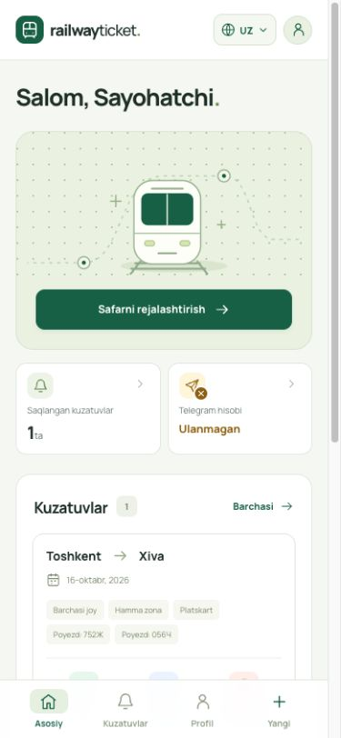
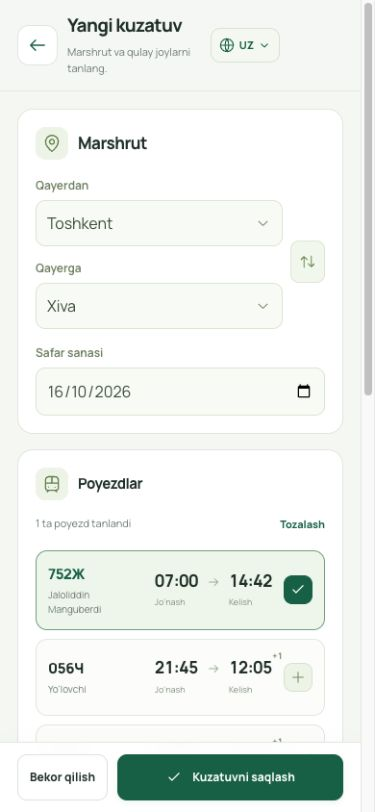

<div align="center">


**Poyezd safarlari uchun Telegram Mini App.**

Yo‘nalish va sanani tanlang. Poyezd va joy filterlari bilan kuzatuv yarating.

**Go · Goravel · PostgreSQL · Vue 3 · TypeScript**

[Ilovani ochish](https://bilet.amusoft.uz) · [Serverga o‘rnatish](DEPLOY.md)

</div>

## Ko‘rinish

<p align="center">
  
  
</p>

## Imkoniyatlar

- Telegram orqali kirish va foydalanuvchi profili.
- O‘zbekcha, ruscha va inglizcha bekatlar; E-ticket’dan reys qidirish.
- Kuzatuv yaratish, ro‘yxatini olish, pauza qilish va o‘chirish.
- Poyezd, vagon turi, joy pozitsiyasi va klass filterlarini saqlash.
- Faol kuzatuvlarni 4 ta goroutine orqali qo‘lda tekshirish.

> Loyiha rivojlanmoqda. Avtomatik premium/free tekshiruvi, filterlarga mos joylarni aniqlash va Telegram xabarnomalari keyingi bosqichda ulanadi.

## Ishga tushirish

Bu repo **Goravel backend** uchun. Rasmlardagi Vue frontend alohida loyihada joylashgan.

Go 1.25+ va PostgreSQL kerak. Baza yarating, `.env.example`dan `.env` nusxasini olib, `DB_*` va `TELEGRAM_BOT_TOKEN` qiymatlarini sozlang.

```sh
cp .env.example .env
go mod download
make key-generate
make migrate-up
make run
```

API: `http://127.0.0.1:8080/api/v1`. Telegram so‘rovlari `Authorization: tma <initData>` header’i bilan yuboriladi.

```sh
./artisan watch:check 1   # Bitta kuzatuvni tekshirish
./artisan check:watches   # Faol kuzatuvlarni tekshirish
make help                # Barcha buyruqlar
```

Ubuntu, Nginx va systemd bilan deploy: **[DEPLOY.md](DEPLOY.md)**.
